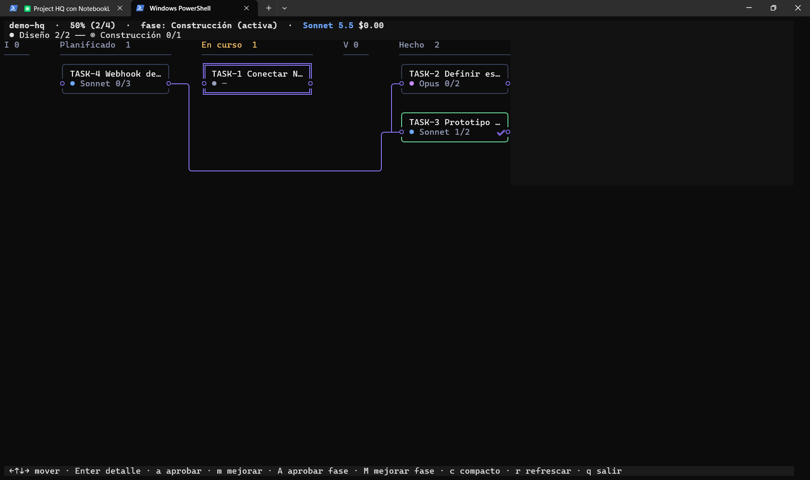

# CC-more-of-claude · plantilla "Project HQ"

Plantilla de un proyecto gestionado con **Claude Code** como orquestador: un tablero de tarjetas, una memoria
persistente en una bóveda de Obsidian y un cuaderno de NotebookLM para los documentos largos. Los ficheros llevan
marcadores `<ASÍ>` que sustituyes por tus propias rutas e ids.



## Qué hace

Convierte una idea en un flujo repetible, con una tarjeta por sesión de Claude:

```
/idea → /planificar → /ejecutar → /revisar → (apruebas tú) → /guardar → /clear
```

| Pieza | Para qué sirve | Dónde vive |
|---|---|---|
| **Tarjetas** | Qué hay que hacer, con criterios de aceptación, dependencias y fases | [Backlog.md](https://github.com/MrLesk/Backlog.md) → `backlog/` |
| **Fases** | Agrupan tarjetas; la siguiente fase no arranca hasta que la apruebas | `.hq/fases.example.json` |
| **Memoria** | Índice del proyecto, decisiones y resúmenes de sesión | Tu bóveda de Obsidian |
| **Documentos largos** | Papers, datasheets, documentación: se consultan sin cargarlos en contexto | Cuaderno de NotebookLM |
| **Agentes** | `arquitecto` (planifica), `ejecutor` (implementa una tarjeta), `revisor` (verifica sin ver la implementación), `explorador` (busca en código), `investigador` (NotebookLM + web), `skill-scout` (recomienda skills) | Plugin `project-hq` de Claude Code |
| **Puerta humana** | Solo tú cierras tarjetas ("Hecho") y apruebas fases; Claude no puede | Hook del plugin + tablero `cc` |

Los estados de una tarjeta son `Ideas → Planificado → En curso → Verificando → Hecho`
(ver `backlog/config.yml`).

## Cómo funciona una sesión

1. **/retomar** carga solo lo imprescindible: el índice del proyecto, la tarjeta activa y las últimas decisiones.
2. **/idea** entrevista (rondas de máx. 5 preguntas) y guarda el resumen de la idea.
3. **/planificar** diseña `docs/ARQUITECTURA.md`, define fases y crea las tarjetas con criterios de aceptación.
4. **/ejecutar siguiente** delega en `ejecutor` la próxima tarjeta lista de la fase activa.
5. **/revisar** pide a `revisor` una verificación independiente contra los criterios.
4b. **Sin gastar tokens**: en `cc`, `i` pasa la tarjeta seleccionada de *Planificado* a *En curso* sin lanzar Claude
   y abre su editor; `E` edita título, descripción, criterios (separados por `|`), modelo y esfuerzo mientras está en
   *Planificado* o *En curso*. Si prefieres que Claude la haga, `e` lanza `/ejecutar` en una pestaña nueva.
6. **Tú decides**: apruebas la tarjeta (`a` en `cc`) o pides cambios (`m`). Al completarse una fase, la apruebas con `A`.
7. **/guardar** deja un resumen en la bóveda y después **/clear**: la siguiente sesión empieza limpia con /retomar.

## Qué contiene este repo

```
CLAUDE.md                  reglas del proyecto para Claude (con marcadores a rellenar)
.hq/project.example.json   metadatos del proyecto: copia a project.json y rellena
.hq/fases.example.json     fases del proyecto y su aprobación (null = pendiente)
backlog/                   tablero Backlog.md: config, hitos y tarjetas de ejemplo
docs/ARQUITECTURA.md       arquitectura (la rellena /planificar)
docs/tablero.png           captura del tablero `cc`
```

## Adaptarlo a tu caso

### 1. Requisitos
- [Claude Code](https://claude.com/claude-code)
- [Backlog.md](https://github.com/MrLesk/Backlog.md) (`backlog` en el PATH)
- Node.js (los comandos del plugin usan scripts `.mjs`)
- Opcional: una bóveda de [Obsidian](https://obsidian.md) y el CLI `nlm` para NotebookLM
- El plugin `project-hq` (comandos `/idea`, `/planificar`, `/ejecutar`, `/revisar`, `/guardar`, `/retomar`
  y los agentes) y, opcionalmente, el tablero de terminal `cc`. Este repo es la plantilla del proyecto; el plugin
  se instala aparte.

### 2. Sustituye los marcadores

| Marcador | Dónde | Qué poner |
|---|---|---|
| `mi-proyecto` | `CLAUDE.md`, `.hq/project.example.json` | El nombre/slug de tu proyecto |
| `<RUTA_DE_TU_BOVEDA>` | `CLAUDE.md` | Ruta de tu bóveda de Obsidian |
| `<ID_DEL_CUADERNO>` / `<ID_DE_TU_CUADERNO_NOTEBOOKLM>` | `CLAUDE.md`, `.hq/project.example.json` | Id de tu cuaderno de NotebookLM (o quita la regla si no lo usas) |
| `<PUERTO>` / `port` | `CLAUDE.md`, `.hq/project.example.json`, `backlog/config.yml` | Un puerto libre para el tablero |
| `<RUTA_DEL_REPO>` | `CLAUDE.md` | Ruta local de tu proyecto |

Después: `cp .hq/project.example.json .hq/project.json` y `cp .hq/fases.example.json .hq/fases.json` (`project.json` está en `.gitignore`, así tus ids y
rutas nunca se suben).

### 3. Ajusta el flujo
- **Modelo por tarjeta** (para gastar menos): cada tarjeta lleva `modelo:<haiku|sonnet|opus>` y
  `esfuerzo:<medium|high|xhigh>`. Se prioriza el más barato que alcance: `haiku` (siempre `medium`) para docs,
  configuración y cambios triviales; `sonnet` para lo corriente; `opus` solo para arquitectura, seguridad,
  concurrencia o migraciones. Si faltan las etiquetas, una rúbrica las deduce de la tarjeta, y cada rechazo del
  revisor (`Falta:`) sube un peldaño: `haiku → sonnet/high → opus/high → opus/xhigh`.
- **Estados y puerto del tablero**: `backlog/config.yml`.
- **Fases**: `.hq/fases.example.json` (un `milestone` por fase, `aprobada: null` hasta que la apruebes).
- **Tarjetas**: borra las de `backlog/tasks/` y `backlog/milestones/` (son ejemplos) y deja que `/planificar` cree las tuyas.
- **Sin Obsidian o sin NotebookLM**: elimina las reglas correspondientes de `CLAUDE.md`; el flujo de tarjetas funciona igual.
