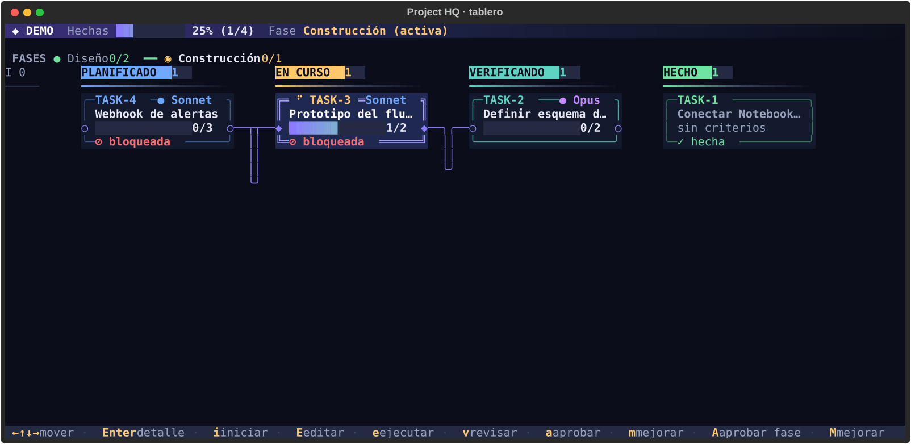
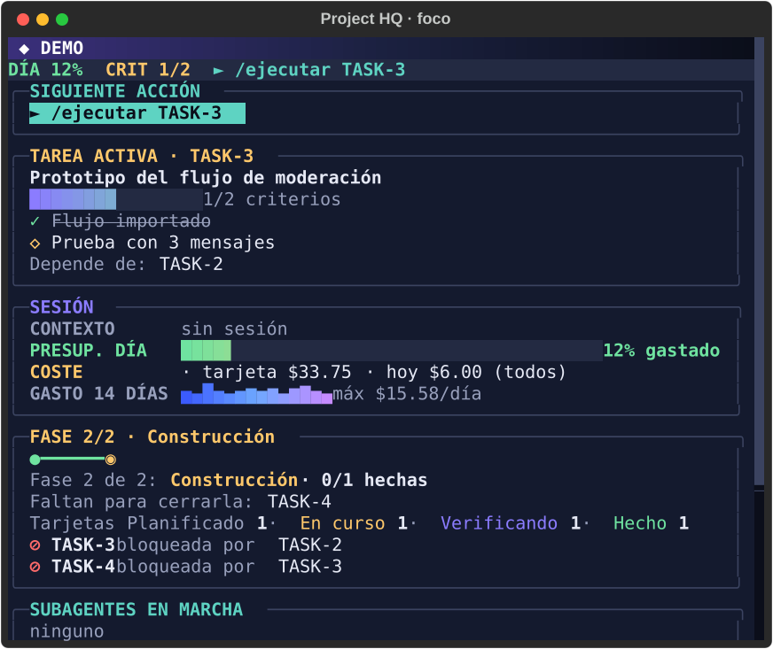
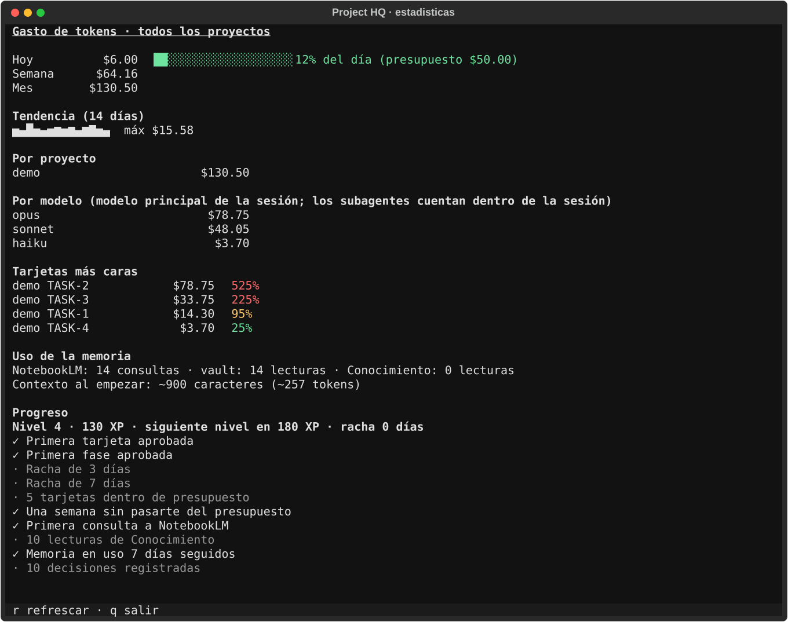
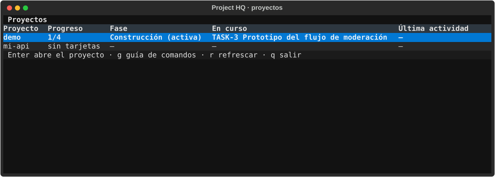

# CC-more-of-claude · Project HQ

Plugin de **Claude Code** (más el comando `cc`) y plantilla de proyecto para trabajar con Claude como orquestador: un tablero de tarjetas, una memoria
persistente en una bóveda de Obsidian y un cuaderno de NotebookLM para los documentos largos. Los ficheros llevan
marcadores `<ASÍ>` que sustituyes por tus propias rutas e ids.

[](LICENSE)
[](https://github.com/alikoubiiss/CC-more-of-claude/actions/workflows/ci.yml)



<details><summary>Más capturas (datos de ejemplo)</summary>

| Foco: siguiente acción, sesión y fase | Estadísticas: gasto y progreso |
|---|---|
|  |  |



Se regeneran con `cd tui && python tools/capturas.py` (usa un HQ ficticio en una carpeta temporal).
</details>

## Instalación (Windows 11)

Project HQ son dos piezas que se instalan desde este mismo repo: el **plugin** de Claude Code (comandos `/idea`,
`/planificar`, `/ejecutar`…, agentes y hooks) y el comando **`cc`** (tablero, feed y notas en Windows Terminal).
Solo funciona en **Windows** (usa `wt.exe` y `clip.exe`).

### 1. Programas que necesitas
**Obligatorios**

| Programa | Para qué sirve | Instalar | Comprobar |
|---|---|---|---|
| [Claude Code](https://claude.com/claude-code) | Orquestador: ejecuta el plugin | ver su web | `claude --version` |
| [Node.js](https://nodejs.org) 22+ | Scripts y hooks del plugin; trae `npm` | `winget install OpenJS.NodeJS` | `node -v` |
| [Git](https://git-scm.com) | Clonar el repo y los repos de tus proyectos | `winget install Git.Git` | `git --version` |
| [Backlog.md](https://github.com/MrLesk/Backlog.md) | Las tarjetas y el tablero | `npm i -g backlog.md` | `backlog --version` |
| [uv](https://docs.astral.sh/uv/) | Instala `cc`; descarga Python 3.12 si no lo tienes | `winget install astral-sh.uv` | `uv --version` |
| [Windows Terminal](https://aka.ms/terminal) | Los paneles de `cc start` (usa `wt.exe`) | `winget install Microsoft.WindowsTerminal` | `where wt` |

**Opcionales** (sin ellos el flujo de tarjetas funciona igual)

| Programa | Para qué sirve | Instalar |
|---|---|---|
| [Obsidian](https://obsidian.md) | Ver y editar la memoria del proyecto (en el tablero, `o` abre la nota). Abre en Obsidian la carpeta del vault (`vaultPath`) | `winget install Obsidian.Obsidian` |
| Plugin *Local REST API* de Obsidian | Solo para que `doctor` compruebe Obsidian: actívalo y guarda su clave en la variable de entorno `HQ_OBSIDIAN_KEY` | desde Obsidian → Plugins de la comunidad |
| `nlm` (NotebookLM) | Consultar documentos largos sin gastar contexto (agente `investigador`) | `uv tool install notebooklm-mcp-cli`, y luego `nlm login --profile hq` (mejor con una cuenta de Google secundaria) |

### 2. Instalar
En PowerShell:
```powershell
git clone https://github.com/alikoubiiss/CC-more-of-claude.git
cd CC-more-of-claude
npm test                                   # opcional: todo debe salir en verde
node scripts/setup.mjs                     # crea tu config en %USERPROFILE%\.project-hq\config.json
uv tool install --editable .\tui           # instala el comando `cc`
claude plugin marketplace add "$PWD"       # o, sin clonar: claude plugin marketplace add alikoubiiss/CC-more-of-claude
claude plugin install project-hq@project-hq
node scripts/doctor.mjs                    # comprueba que todo está listo
```
`setup.mjs` acepta `--vault <ruta>`, `--proyectos <ruta>`, `--perfil-nlm <nombre>` y `--puerto <n>`.
Si `cc` no se reconoce, cierra y abre la terminal (uv lo deja en `%USERPROFILE%\.local\bin`; `uv tool update-shell` lo añade al PATH).

`doctor` marca `✓` (bien), `✗` (hay que arreglarlo) y `!` (pieza opcional que falta: `nlm`, su login, `cc` o `wt`).
Solo los `✗` impiden usar HQ.

### 3. Tu primer proyecto
1. Abre Claude Code en cualquier carpeta y ejecuta `/project-hq:nuevo-proyecto mi-proyecto`. Crea el repo en
   `projectsRoot`, el tablero, la nota en el vault y, si tienes `nlm`, el cuaderno, y lo registra en HQ.
2. En una terminal: `cd <projectsRoot>\mi-proyecto` y `cc start`. Abre Claude Code, el tablero, el feed y las notas.
   (`cc start` solo reconoce proyectos creados con `/nuevo-proyecto`; fuera de uno muestra la lista.)
3. Dentro de Claude Code: `/idea` → `/planificar` → `/ejecutar siguiente` → `/revisar`. En el tablero apruebas con `a`.

### 4. Qué es tuyo y no se sube a GitHub
Todo lo personal queda fuera del repo (`.gitignore`). Esto es lo que tienes que poner tú:

| Qué | Dónde | Qué poner |
|---|---|---|
| Config global | `%USERPROFILE%\.project-hq\config.json` (la crea `setup.mjs`; plantilla en `config.example.json`) | `vaultPath` (tu bóveda de Obsidian), `projectsRoot` (donde viven tus proyectos), `dataDir` (absoluta; estado, registro y métricas), `nlmProfile`, `basePort`, `presupuesto` |
| Perfil de NotebookLM | `nlm login --profile <nlmProfile>` | Tu cuenta de Google; las credenciales las guarda `nlm`, nunca este repo |
| Clave de Obsidian *(opcional)* | variable de entorno `HQ_OBSIDIAN_KEY` | La API key del plugin *Local REST API* de Obsidian |
| Proyecto | `.hq/project.json` (copia de `.hq/project.example.json`) | Slug, id de tu cuaderno de NotebookLM y puerto |
| Reglas del proyecto | `CLAUDE.md` | Sustituye los marcadores `<RUTA_DE_TU_BOVEDA>`, `<ID_DEL_CUADERNO>`, `<PUERTO>`… |
| Redactor de datos personales *(opcional)* | `vault-redactor.json` junto a la config | Tus términos a ocultar al exportar notas al vault de HQ (ejemplo en `templates/`) |

La config se busca en este orden: variable `HQ_CONFIG`, `%USERPROFILE%\.project-hq\config.json` y, por último,
un `config.json` junto al código. Nunca subas ese fichero, tus ids de cuaderno ni tu clave de Obsidian.

### 5. Actualizar
`git pull` en tu clon y `claude plugin update project-hq@project-hq`. Tu config y tu estado no se tocan
porque viven en `%USERPROFILE%\.project-hq`.

## Qué hace

Convierte una idea en un flujo repetible, con una tarjeta por sesión de Claude:

```
/idea → /planificar → /ejecutar → /revisar → (apruebas tú) → /guardar → /clear
```

| Pieza | Para qué sirve | Dónde vive |
|---|---|---|
| **Tarjetas** | Qué hay que hacer, con criterios de aceptación, dependencias y fases | [Backlog.md](https://github.com/MrLesk/Backlog.md) → `backlog/` |
| **Fases** | Agrupan tarjetas; la siguiente fase no arranca hasta que la apruebas | `.hq/fases.example.json` |
| **Memoria** | Índice del proyecto, decisiones y resúmenes de sesión | Tu bóveda de Obsidian |
| **Documentos largos** | Papers, datasheets, documentación: se consultan sin cargarlos en contexto | Cuaderno de NotebookLM |
| **Agentes** | `arquitecto` (planifica), `ejecutor` (implementa una tarjeta), `revisor` (verifica sin ver la implementación), `explorador` (busca en código), `investigador` (NotebookLM + web), `skill-scout` (recomienda skills) | Plugin `project-hq` de Claude Code |
| **Puerta humana** | Solo tú cierras tarjetas ("Hecho") y apruebas fases; Claude no puede | Hook del plugin + tablero `cc` |

Los estados de una tarjeta son `Ideas → Planificado → En curso → Verificando → Hecho`
(ver `backlog/config.yml`).

## Cómo funciona una sesión

1. **/retomar** carga solo lo imprescindible: el índice del proyecto, la tarjeta activa y las últimas decisiones.
2. **/idea** entrevista (rondas de máx. 5 preguntas) y guarda el resumen de la idea.
3. **/planificar** diseña `docs/ARQUITECTURA.md`, define fases y crea las tarjetas con criterios de aceptación.
4. **/ejecutar siguiente** delega en `ejecutor` la próxima tarjeta lista de la fase activa.
5. **/revisar** pide a `revisor` una verificación independiente contra los criterios.
4b. **Sin gastar tokens**: en `cc`, `i` pasa la tarjeta seleccionada de *Planificado* a *En curso* sin lanzar Claude
   y abre su editor; `E` edita título, descripción, criterios (separados por `|`), modelo y esfuerzo mientras está en
   *Planificado* o *En curso*. Si prefieres que Claude la haga, `e` lanza `/ejecutar` en una pestaña nueva.
6. **Tú decides**: apruebas la tarjeta (`a` en `cc`) o pides cambios (`m`). Al completarse una fase, la apruebas con `A`.
7. **/guardar** deja un resumen en la bóveda y después **/clear**: la siguiente sesión empieza limpia con /retomar.

## Qué contiene este repo

```
CLAUDE.md                  reglas del proyecto para Claude (con marcadores a rellenar)
.hq/project.example.json   metadatos del proyecto: copia a project.json y rellena
.hq/fases.example.json     fases del proyecto y su aprobación (null = pendiente)
backlog/                   tablero Backlog.md: config, hitos y tarjetas de ejemplo
docs/ARQUITECTURA.md       arquitectura (la rellena /planificar)
docs/capturas/             capturas SVG del tablero `cc` (las genera tui/tools/capturas.py)
```

## Adaptarlo a tu caso

### 1. Dependencias de la plantilla
- [Claude Code](https://claude.com/claude-code)
- [Backlog.md](https://github.com/MrLesk/Backlog.md) (`backlog` en el PATH)
- Node.js (los comandos del plugin usan scripts `.mjs`)
- Opcional: una bóveda de [Obsidian](https://obsidian.md) y el CLI `nlm` para NotebookLM
- El plugin `project-hq` y el comando `cc` (ver **Instalación** arriba).

### 2. Sustituye los marcadores

| Marcador | Dónde | Qué poner |
|---|---|---|
| `mi-proyecto` | `CLAUDE.md`, `.hq/project.example.json` | El nombre/slug de tu proyecto |
| `<RUTA_DE_TU_BOVEDA>` | `CLAUDE.md` | Ruta de tu bóveda de Obsidian |
| `<ID_DEL_CUADERNO>` / `<ID_DE_TU_CUADERNO_NOTEBOOKLM>` | `CLAUDE.md`, `.hq/project.example.json` | Id de tu cuaderno de NotebookLM (o quita la regla si no lo usas) |
| `<PUERTO>` / `port` | `CLAUDE.md`, `.hq/project.example.json`, `backlog/config.yml` | Un puerto libre para el tablero |
| `<RUTA_DEL_REPO>` | `CLAUDE.md` | Ruta local de tu proyecto |

Después: `cp .hq/project.example.json .hq/project.json` y `cp .hq/fases.example.json .hq/fases.json` (`project.json` está en `.gitignore`, así tus ids y
rutas nunca se suben).

### 3. Ajusta el flujo
- **Modelo por tarjeta** (para gastar menos): cada tarjeta lleva `modelo:<haiku|sonnet|opus>` y
  `esfuerzo:<medium|high|xhigh>`. Se prioriza el más barato que alcance: `haiku` (siempre `medium`) para docs,
  configuración y cambios triviales; `sonnet` para lo corriente; `opus` solo para arquitectura, seguridad,
  concurrencia o migraciones. Si faltan las etiquetas, una rúbrica las deduce de la tarjeta, y cada rechazo del
  revisor (`Falta:`) sube un peldaño: `haiku → sonnet/high → opus/high → opus/xhigh`.
- **Estados y puerto del tablero**: `backlog/config.yml`.
- **Fases**: `.hq/fases.example.json` (un `milestone` por fase, `aprobada: null` hasta que la apruebes).
- **Tarjetas**: borra las de `backlog/tasks/` y `backlog/milestones/` (son ejemplos) y deja que `/planificar` cree las tuyas.
- **Sin Obsidian o sin NotebookLM**: elimina las reglas correspondientes de `CLAUDE.md`; el flujo de tarjetas funciona igual.

## Problemas frecuentes

| Síntoma | Causa y solución |
|---|---|
| `cc` no se reconoce | Cierra y abre la terminal; si sigue, `uv tool update-shell`. |
| `doctor` marca `✗ config` | Falta tu config: `node scripts/setup.mjs` (o define `HQ_CONFIG`). |
| `cc start` abre la lista en vez del proyecto | La carpeta no está registrada: crea el proyecto con `/project-hq:nuevo-proyecto`. |
| Cambié código y el plugin no lo recoge | Claude Code usa una copia en `~/.claude/plugins/cache/`: sube `version` en `.claude-plugin/plugin.json` o ejecuta `claude plugin update project-hq@project-hq`. |
| Un paso de NotebookLM falla | Es opcional: comprueba `nlm login --profile <nlmProfile>` o quita la regla del `CLAUDE.md`. |

## Contribuir y licencia
Las contribuciones son bienvenidas: lee [CONTRIBUTING.md](CONTRIBUTING.md). Historial de versiones en [CHANGELOG.md](CHANGELOG.md). Licencia [MIT](LICENSE).

# Referencia del plugin

## Comando `cc` en la terminal
Paneles en Windows Terminal: Claude Code, tablero vivo y foco (tarjeta activa, contexto, coste, git).
- **Instalar `cc`:** `uv tool install --editable "<ruta>\project-hq\tui"` (deja `cc.exe` en `~\.local\bin`). Tests: `cd tui && PYTHONUTF8=1 .venv\Scripts\python.exe -m unittest discover -s tests -t .`
- **Uso diario:** **`cc start`** (lo más fácil: abre todo del proyecto de la carpeta donde estás; fuera de un proyecto, la lista; también `cc start <proyecto>`), `cc` (todos los proyectos; Enter abre uno), `cc board|feed|notes|focus [proyecto]` (sin nombre usa el proyecto de la carpeta actual), `cc open <proyecto>` (abre la ventana maximizada con Claude, tablero y foco en una sola pestaña). `/nuevo-proyecto` la abre solo al terminar.
- **Teclas del tablero:** flechas/`hjkl` mover, Enter detalle (descripción, criterios, comentarios), **`e` ejecuta** la tarjeta seleccionada (Planificado o En curso) y **`v` la revisa** (Verificando sin revisar): piden confirmación y abren Claude Code en una pestaña nueva de la ventana actual con `/project-hq:ejecutar` o `/project-hq:revisar` ya escrito; `>` y `<` mueven la tarjeta seleccionada de columna (a «Hecho» solo se llega aprobando con `a`), `c` compacto, `r` refrescar, `q` salir.
- **Tamaño de los paneles:** son paneles de Windows Terminal y se ajustan a tu gusto con **Alt+Mayús+flechas** (el tablero se adapta solo; con poco ancho pasa a modo compacto y se desplaza). Windows Terminal no ofrece un comando para redimensionar desde dentro de un panel. Notas: `o` abre en Obsidian, `e` en el editor.
- `node scripts/hq-open.mjs <proyecto> --dry-run` muestra el reparto de paneles que abrirá `wt.exe`.
- **Puertas humanas:** ninguna tarjeta pasa a «Hecho» ni ninguna fase avanza sin ti. En `cc`: `a`/`m` (aprobar/mejorar tarjeta, solo en «Verificando» con `revisada`) y `A`/`M` (fase lista), siempre con diálogo de confirmación. Sin `hq`, a mano: `! backlog task edit <id> --status Hecho` en el prompt de Claude Code, y `node scripts/fases.mjs approve <id>` en tu propia terminal. Un hook (`hooks/gate.mjs`) bloquea a los agentes que lo intenten (defensa en profundidad, no garantía).
- Fases: `node scripts/fases.mjs set|status` (hitos de Backlog.md; solo trabaja la fase activa).
- Statusline: `scripts/statusline.mjs` (se activa en `~/.claude/settings.json`). Eventos en `<dataDir>\events\` y estado de sesión en `<dataDir>\state\`; ni prompts ni respuestas de herramientas se guardan, y los secretos comunes se redactan.


## Gasto de tokens y progreso
Para controlar y reducir el gasto: la statusline de Claude Code guarda un historial **solo con números** (coste, tokens, modelo y tarjeta: la «En curso» o, si no hay, la de «Verificando» aún sin `revisada` tocada más tarde) en `<dataDir>\metrics\<proyecto>\AAAA-MM-DD.jsonl`, y los hooks anotan el uso de la memoria (consultas a NotebookLM, lecturas del vault y de `Conocimiento`, contexto inyectado al empezar). Nada de texto de prompts ni respuestas; se conserva 400 días.
- **`cc stats [proyecto]`:** gasto de hoy, semana y mes, por proyecto, por tarjeta y por modelo, tendencia de 14 días, uso de la memoria y tu progreso (nivel, XP, racha, logros). El modelo es el **principal de la sesión**: los subagentes cuentan dentro de la sesión pero Claude Code no da su coste aparte. Una sesión que ya estaba en marcha al activar el sistema no arrastra lo gastado antes.
- **Presupuesto (`config.json` → `presupuesto: {diaUsd, tarjetaUsd}`):** al 80 % y al 100 % aparece `⚠ día 82%` / `⚠ TASK-3 104%` en la statusline (ámbar y rojo), en `cc stats` y en el tablero. **No bloquea nada.** Los valores iniciales (50 y 15 USD) son un punto de partida: cámbialos.
- **XP (solo por lo que verificas tú):** tarjeta aprobada +10 (+5 si costó menos que `tarjetaUsd`), fase aprobada +50, día cerrado con gasto dentro de `diaUsd` +5. 10 niveles y 10 logros; todo se calcula al leer, sin base de datos propia. No hay estimaciones de ahorro: el panel muestra el gasto real y su tendencia.


## Comandos
| Comando | Qué hace |
|---|---|
| `/nuevo-proyecto <nombre>` | Repo + Backlog.md + nota en el vault + cuaderno NotebookLM + abre el tablero |
| `/idea` | Entrevista (≤5 preguntas por ronda) |
| `/planificar` | Arquitectura, decisiones y tarjetas con criterios, modelo y esfuerzo (Opus); pasa el lint de tarjetas |
| `/ejecutar [id\|siguiente]` | Una tarjeta con el subagente `ejecutor`, con el modelo y el esfuerzo de la tarjeta |
| `/revisar` | Verificación independiente (`revisor`), con el modelo de revisor de la tarjeta |
| `/guardar` | Resumen de sesión y estado al vault |
| `/retomar` | Índice + tarjeta activa + últimas decisiones |

Los comandos aparecen como `/project-hq:<comando>` si hay conflicto de nombres.


## Modelo y esfuerzo por tarjeta
Al crear cada tarjeta, el `arquitecto` le pone las etiquetas `modelo:<haiku|sonnet|opus>`, `esfuerzo:<medium|high|xhigh>`, `riesgo:<bajo|medio|alto>` y `est:<minutos>` (además de `skill:`). `/ejecutar` y `/revisar` las leen con `node scripts/modelo-tarjeta.mjs <id>` y llaman al subagente con `model` y `effort` explícitos (tienen prioridad sobre el frontmatter del agente). Se prioriza el modelo más barato que alcance: **Haiku** para lo mínimo (siempre con esfuerzo `medium`), **Sonnet** para lo corriente y **Opus** (el tope) solo para lo difícil. Haiku también explora (`explorador`, `skill-scout`).

| Tipo de tarea | Ejecutor | Revisor |
|---|---|---|
| Arquitectura, seguridad, concurrencia, migraciones o datos irreversibles | opus / xhigh | opus / high + tarjeta `Verificar TASK-n` |
| Lógica compleja, integraciones externas, rendimiento | opus / high | opus / high |
| Interfaz con criterio visual, refactor amplio (>5 ficheros) | opus / medium | opus / high |
| Funcionalidad corriente, tests, refactor mecánico acotado | sonnet / high | sonnet / high |
| Docs, configuración, cambios triviales (1 fichero, 1-2 criterios) | haiku / medium | sonnet / medium |
| Cambios pequeños con algo de lógica | sonnet / medium | sonnet / medium |

- **Rúbrica** (si faltan etiquetas, y como aviso del lint): +2 por seguridad o datos, concurrencia, >3 criterios, >5 ficheros, criterio ambiguo, ≥2 tarjetas dependientes. 0 y tarjeta mínima → haiku; 0 en el resto o 2-4 → sonnet/high; ≥6 → opus/high; `riesgo:alto` → opus/xhigh.
- **Revisor:** nunca más débil que la tarjeta ni que el ejecutor tras escalar; `riesgo:alto` → opus/high. Sigue sin ver la implementación y solo tú mueves a «Hecho».
- **Escalera de reintentos:** cada comentario `Falta:` (del revisor o tuyo con la tecla `m`) sube un peldaño: nivel de la tarjeta → sonnet/high → opus/high → opus/xhigh. Tras 2 rechazos en opus/xhigh, `parar: true`: `/ejecutar` no lanza nada y pide dividir la tarjeta.
- **Rastro:** ejecutor y revisor dejan `Modelo: <alias>/<esfuerzo> intento <n>` en la tarjeta (`modelo-tarjeta.mjs <id> --registrar ejecutor|revisor`). Los eventos guardan el modelo pedido al lanzar el subagente (`req_model`, `req_effort`) y, en SubagentStop, el de ese comentario (`model_src: tarjeta`); en SubagentStart (y si no hay comentario) el del frontmatter como respaldo (`model_src: mapa`).
- **Lint:** `node scripts/lint-tarjetas.mjs [TASK-n…] [--todas] [--json]` (por defecto las tarjetas en «Planificado»). Rechaza tarjetas sin `modelo:`/`esfuerzo:`/`est:`, sin descripción, con <2 o >5 criterios, `est:` >90, modelo distinto de haiku/sonnet/opus, `haiku` con esfuerzo distinto de medium, `riesgo:alto` sin opus o sin su `Verificar TASK-n`; avisa si contradice la rúbrica. Sale con código 1 si hay errores.
- **Sin gastar tokens desde el tablero:** `i` pasa una tarjeta de Planificado a En curso sin lanzar Claude (respeta las fases pendientes) y abre su editor; `E` edita título, descripción, criterios (separados por `|`), modelo y esfuerzo de una tarjeta en Planificado o En curso.


## Tests
`npm test` (hermético: carpetas temporales y runners simulados; no toca el vault real). Pantallas de `cc`: `cd tui && python -m unittest discover -s tests -t .` (con `uv pip install -e .`). Ambas suites corren en CI en cada push.
